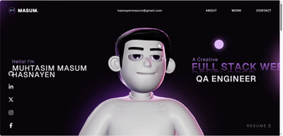

# 🚀 My Portfolio Website — Muhtasim Masum Hasnayen
<p align="center">
  
</p>
<p align="center">
  
  
  
  
</p>

<p align="center">
  <b>A creative, interactive portfolio showcasing my technical skills, projects, and journey as a Computer Science and Engineering enthusiast.</b>
</p>

<p align="center">
  <a href="https://my-portfolio-iota-taupe-53.vercel.app/">
    
  </a>
  <a href="https://muhtasim-masum-38.lovable.app/">
    
  </a>
</p>

---

## 👋 About This Project

Welcome to the source code of my personal portfolio website!

This project represents my interest in modern web development, interactive user experiences, creative animation, and 3D web technologies. It combines a responsive interface with motion-driven elements to create a distinctive digital presence.

**The goal:** Present my skills, projects, and development journey through an engaging and memorable web experience.

### 🔗 Portfolio Links

| Version | Link |
|---|---|
| 🆕 **New Portfolio** | [Visit Live Website](https://my-portfolio-iota-taupe-53.vercel.app/) |
| 🕰️ **Previous Portfolio** | [Explore Old Website](https://muhtasim-masum-38.lovable.app/) |
| 💻 **Source Code** | [View Repository](https://github.com/Muftasim-Masum-Hasnayen/my-portfolio) |
| 👨‍💻 **GitHub Profile** | [Muhtasim Masum Hasnayen](https://github.com/Muhtasim-Masum-Hasnayen) |

---

## ✨ Highlights

- 🎨 **Modern UI:** A distinctive visual style with interactive interface elements.
- 🌀 **Motion & Animation:** GSAP-powered animation and scroll interactions.
- 🌐 **3D Web Experience:** Three.js and WebGL-based visual components.
- 📱 **Responsive Design:** Designed to support different screen sizes.
- ⚡ **Modern Frontend:** Built with React, TypeScript, and Vite.
- 🧩 **Developer Portfolio:** A personal space to showcase skills, projects, and technical interests.

---

## 🛠️ Tech Stack

<p>
  
</p>

| Technology | Purpose |
|---|---|
| React | Component-based user interface |
| TypeScript | Type-safe application development |
| Vite | Development server and production build |
| GSAP | Animation and scroll interactions |
| Three.js | 3D graphics and WebGL experiences |
| HTML5 & CSS3 | Structure, styling, and responsive layouts |
| JavaScript | Interactive application logic |
| Git & GitHub | Version control and source code hosting |
| Vercel | Live deployment and hosting |

---

## 🚀 Run Locally

Want to explore the source code on your machine? Follow these steps.

### Prerequisites

- [Node.js](https://nodejs.org/) — an appropriate LTS version
- npm
- Git

### 1. Clone the repository

```bash
git clone https://github.com/Muftasim-Masum-Hasnayen/my-portfolio.git
```

### 2. Navigate to the project

```bash
cd my-portfolio
```

### 3. Install dependencies

```bash
npm install
```

### 4. Start the development server

```bash
npm run dev
```

Open the local URL displayed in your terminal.

### 5. Create a production build

```bash
npm run build
```

To preview the production build locally:

```bash
npm run preview
```

---

## 🎬 GSAP Plugin & Production Notes

This project uses GSAP for animation and interactive scrolling effects.

Some GSAP Club plugins may require a valid license or authorized access. **Do not deploy trial-only plugin builds to production.**

For official installation instructions and licensing information, refer to the GSAP documentation:

- [GSAP Installation Guide](https://gsap.com/docs/v3/Installation/)
- [GSAP Documentation](https://gsap.com/docs/v3/)
- [GSAP Licensing Information](https://gsap.com/licensing/)

The source code has been adjusted to use the standard GSAP package imports for the plugins configured in this project. Plugin availability and licensing requirements may vary by plugin and GSAP version.

---

## 🎨 3D Assets & Attribution

This repository may contain third-party or sample 3D assets intended for learning and development.

Please respect the ownership and license terms of every asset.

- **Custom portfolio avatar:** The original custom 3D avatar displayed on my live portfolio is not included in this repository.
- **Ownership:** The avatar is a custom asset developed over approximately one month and is not offered as an open-source asset.
- **Reuse restrictions:** Do not extract, download, reproduce, redistribute, or reuse that avatar without my explicit permission.
- **Third-party assets:** Any included third-party assets remain subject to their respective creators' licenses.

Please do not assume that an asset is reusable simply because it is visible on a public website.

---

## ⚠️ Usage Policy

This repository is published to demonstrate my development work and support learning and technical exploration.

**Please respect the originality of this project.**

- Do not clone and republish the complete website as your own portfolio.
- Do not reproduce the overall design with only minor changes and claim it as original work.
- Do not use this project as a ready-made commercial or client deliverable without permission.
- Do not create tutorials or content presenting this exact project as your original work without prior permission.
- If you reference or reuse permitted portions of the code, provide clear attribution and link back to this repository.
- Review the license before copying, modifying, or distributing any part of the project.

You are encouraged to learn from the implementation and build your **own original version**.

> Learn from the code. Respect the creator. Build something of your own.

---

## 📄 License

This project is intended to be distributed under the **Personal Portfolio License (PPL) v1.0**.

Please read the [`LICENSE`](./LICENSE) file for the complete terms, permissions, restrictions, and conditions of use.

If the LICENSE file is missing from the repository, add it before relying on this license notice. The name “Personal Portfolio License” alone does not establish legally enforceable terms; the actual license text governs usage.

---

## 🤝 Connect With Me

I'm interested in software development, Software Quality Assurance, test automation, Artificial Intelligence, and Machine Learning.

<p>
  <a href="https://github.com/Muftasim-Masum-Hasnayen">
    
  </a>
  <a href="https://my-portfolio-iota-taupe-53.vercel.app/">
    
  </a>
  <a href="https://www.linkedin.com/">
    
  </a>
</p>

---

<p align="center">
  <b>Designed to express creativity. Built to showcase engineering.</b>
  <br />
  © Muhtasim Masum Hasnayen
</p>
